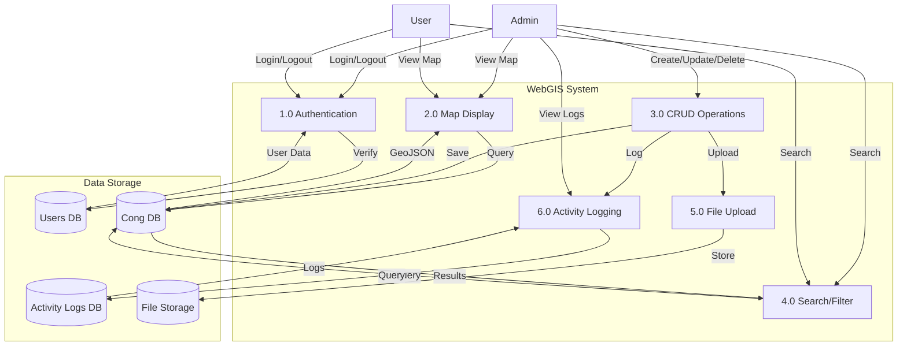
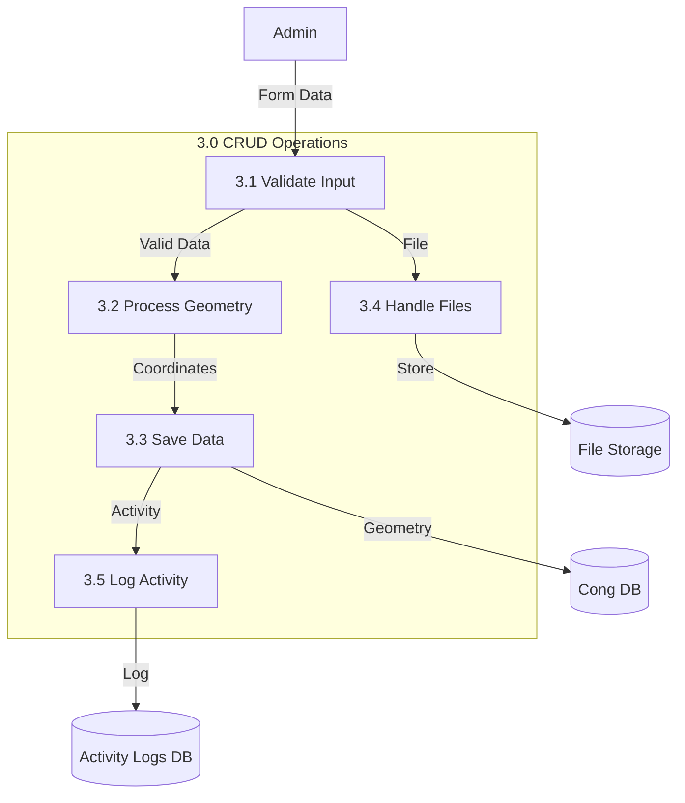
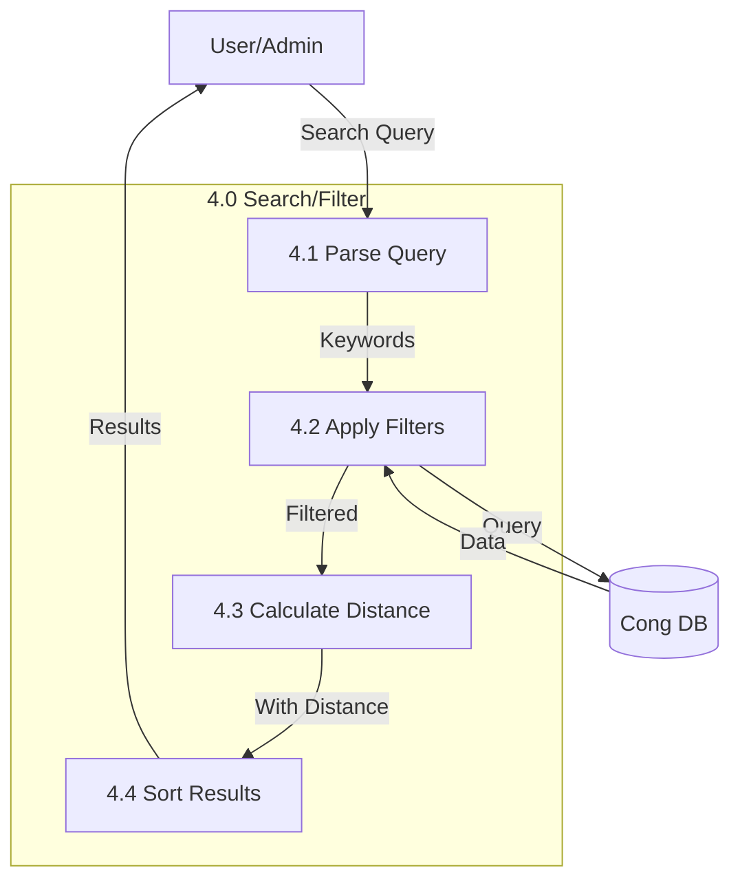

# Sơ đồ DFD (Data Flow Diagram)

## Mô tả
Sơ đồ DFD mô tả luồng dữ liệu trong hệ thống WebGIS quản lý cống.

## DFD Level 0 - Context Diagram

### Mô tả Level 0
- **External Entities:** Admin, User
- **System:** WebGIS System
- **Data Flows:**
  - Admin → System: Requests (CRUD operations, view logs)
  - User → System: Requests (view map, search)
  - System → Admin: Responses (data, confirmations)
  - System → User: Responses (map data, search results)

## DFD Level 1 - Main Processes

### Chi tiết các Process

#### 1.0 Authentication (Xác thực)
- **Input:** Email, Password
- **Process:**
  - Validate credentials
  - Create session
  - Set user role
- **Output:** Session token, User data
- **Data Store:** Users DB
- **Logging:** Activity Logs DB

#### 2.0 Map Display (Hiển thị bản đồ)
- **Input:** Map view request
- **Process:**
  - Load GeoJSON data from database
  - Convert geometry to GeoJSON format
  - Render on Leaflet map
- **Output:** Map with markers
- **Data Store:** Cong DB

#### 3.0 CRUD Operations (Thao tác CRUD)
- **Input:** Create/Update/Delete requests
- **Process:**
  - Validate input data
  - Create/Update geometry from coordinates
  - Save to database
  - Handle file uploads
  - Log activities
- **Output:** Success/Error messages
- **Data Store:** Cong DB, File Storage
- **Logging:** Activity Logs DB

#### 4.0 Search/Filter (Tìm kiếm/Lọc)
- **Input:** Search keywords, filters
- **Process:**
  - Parse search query
  - Filter data by criteria
  - Calculate distances (if needed)
  - Sort results
- **Output:** Filtered results
- **Data Store:** Cong DB

#### 5.0 File Upload (Upload file)
- **Input:** File data
- **Process:**
  - Validate file type and size
  - Generate unique filename
  - Store file
  - Save file metadata
- **Output:** File URL
- **Data Store:** File Storage

#### 6.0 Activity Logging (Ghi log)
- **Input:** Activity data
- **Process:**
  - Capture user action
  - Record IP address, user agent
  - Store changes (for update/delete)
  - Save to logs
- **Output:** Log entry
- **Data Store:** Activity Logs DB

## DFD Level 2 - Detailed Processes

### 3.0 CRUD Operations - Chi tiết

### 4.0 Search/Filter - Chi tiết

## Data Dictionary

### Data Stores

#### D1: Users DB
- **Description:** Lưu trữ thông tin người dùng
- **Contents:** id, name, email, password, role, timestamps

#### D2: Cong DB
- **Description:** Lưu trữ dữ liệu cống
- **Contents:** ogc_fid, id, ten_cong_dap, coordinates, geometry, file info, metadata

#### D3: Activity Logs DB
- **Description:** Lưu trữ lịch sử hoạt động
- **Contents:** id, user_id, action, model_type, model_id, description, ip_address, changes, timestamp

#### D4: File Storage
- **Description:** Lưu trữ file đính kèm
- **Contents:** Image files, PDF files

### Data Flows

#### User Request
- **From:** Admin/User
- **To:** System Processes
- **Contents:** HTTP request với parameters, form data

#### GeoJSON Data
- **From:** Cong DB
- **To:** Map Display
- **Contents:** FeatureCollection với geometry và properties

#### Search Results
- **From:** Search Process
- **To:** User
- **Contents:** Filtered list of culverts with metadata

#### Log Entry
- **From:** Activity Logging
- **To:** Activity Logs DB
- **Contents:** User action, timestamp, IP, changes

