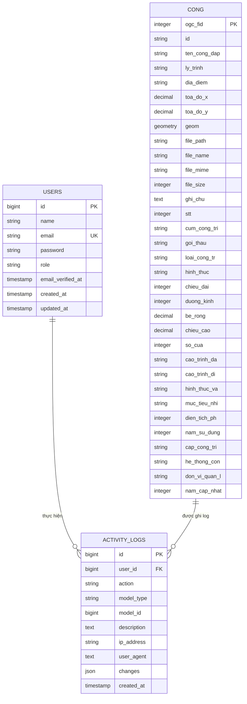

# Sơ đồ ERD (Entity Relationship Diagram)

## Mô tả
Sơ đồ ERD mô tả cấu trúc database và mối quan hệ giữa các bảng trong hệ thống WebGIS quản lý cống.

## Sơ đồ ERD

## Mối quan hệ

### 1. USERS ↔ ACTIVITY_LOGS
- **Loại:** One-to-Many
- **Mô tả:** Một user có thể thực hiện nhiều hoạt động (logs)
- **Foreign Key:** `activity_logs.user_id` → `users.id`
- **On Delete:** SET NULL (nếu xóa user, logs vẫn giữ lại nhưng user_id = null)

### 2. CONG ↔ ACTIVITY_LOGS
- **Loại:** One-to-Many (polymorphic)
- **Mô tả:** Một cống có thể có nhiều log (create, update, delete, view)
- **Foreign Key:** `activity_logs.model_type` = 'App\Models\Cong' và `activity_logs.model_id` = `cong.ogc_fid`
- **Đặc biệt:** Sử dụng polymorphic relationship thông qua `model_type` và `model_id`

## Ghi chú

### Bảng USERS
- `id`: Primary key, tự động tăng
- `email`: Unique, dùng để đăng nhập
- `role`: 'admin' hoặc 'user', xác định quyền truy cập
- `password`: Đã được hash bằng bcrypt

### Bảng CONG
- `ogc_fid`: Primary key (PostGIS convention)
- `id`: Mã số cống (có thể trùng, không unique)
- `geom`: Cột geometry PostGIS, lưu Point geometry (SRID 4326)
- `toa_do_x`, `toa_do_y`: Tọa độ X, Y (backup, không dùng cho spatial query)
- Các trường khác: Thông tin chi tiết về cống

### Bảng ACTIVITY_LOGS
- `id`: Primary key, tự động tăng
- `user_id`: Foreign key đến users (nullable)
- `action`: 'create', 'update', 'delete', 'view', 'login', 'logout'
- `model_type`: Tên class model (polymorphic)
- `model_id`: ID của model (polymorphic)
- `description`: Mô tả chi tiết hoạt động
- `changes`: JSON chứa thay đổi (old/new values)
- `ip_address`: Địa chỉ IP của người dùng
- `user_agent`: Thông tin browser

## Indexes

### Bảng USERS
- `email`: UNIQUE index
- `role`: Index để filter theo role

### Bảng CONG
- `ogc_fid`: Primary key index
- `geom`: Spatial index (GIST) cho PostGIS
- `id`: Index để tìm kiếm
- `ten_cong_dap`: Index để tìm kiếm

### Bảng ACTIVITY_LOGS
- `user_id`: Index
- `action`: Index
- `(model_type, model_id)`: Composite index
- `created_at`: Index để sort và filter theo thời gian

