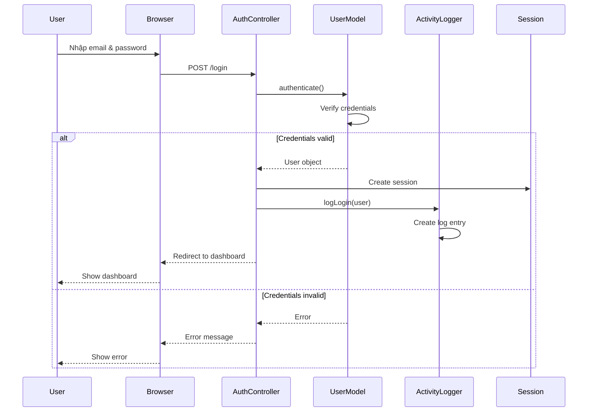
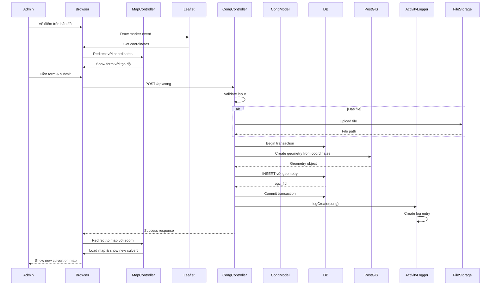
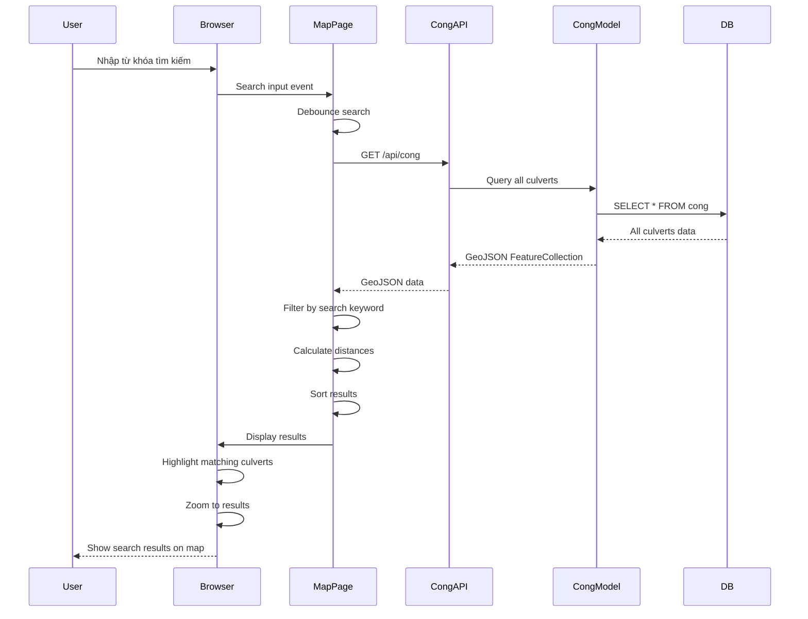
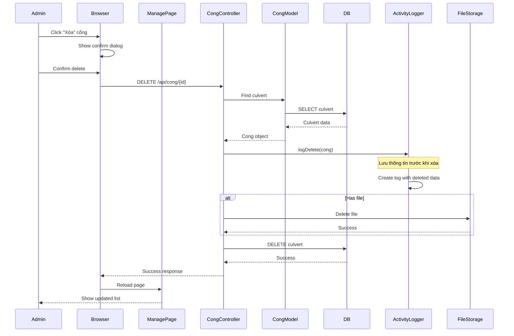
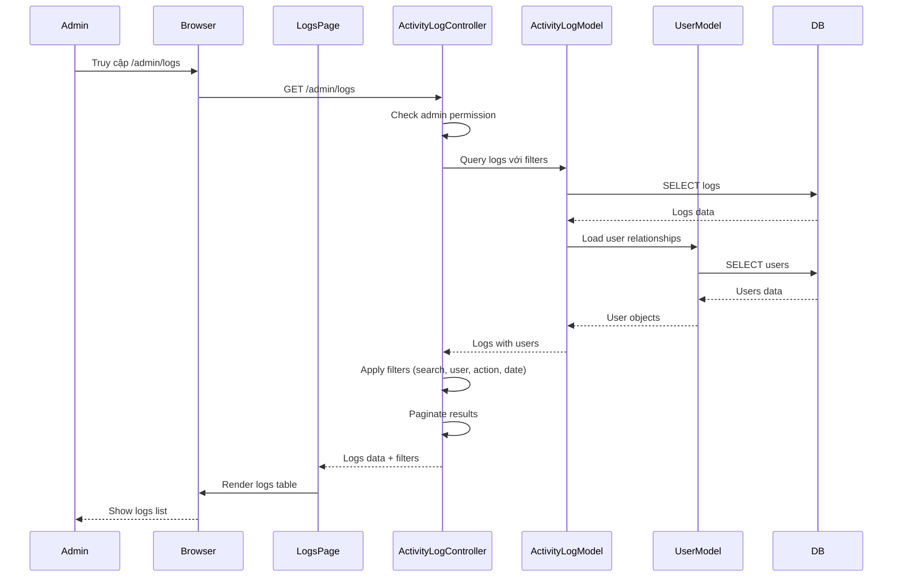

# Sơ đồ Sequence Diagram

## Mô tả
Sơ đồ Sequence mô tả trình tự tương tác giữa các thành phần trong hệ thống khi thực hiện các use case chính.

## 1. Sequence Diagram - Đăng nhập

## 2. Sequence Diagram - Thêm cống mới

## 3. Sequence Diagram - Tìm kiếm cống

## 4. Sequence Diagram - Cập nhật cống

```mermaid
sequenceDiagram
    participant Admin
    participant Browser
    participant ManagePage
    participant CongController
    participant CongModel
    participant DB
    participant PostGIS
    participant ActivityLogger
    participant FileStorage
    
    Admin->>Browser: Click "Sửa" cống
    Browser->>ManagePage: Load culvert data
    ManagePage->>CongAPI: GET /api/cong
    CongAPI-->>ManagePage: Culvert data
    ManagePage->>Browser: Show edit form
    
    Admin->>Browser: Điền form & submit
    Browser->>CongController: PUT /api/cong/{id}
    CongController->>CongModel: Find culvert
    CongModel->>DB: SELECT culvert
    DB-->>CongModel: Culvert data
    CongModel-->>CongController: Cong object
    
    CongController->>CongController: Validate & prepare data
    alt Has file upload
        CongController->>FileStorage: Delete old file
        CongController->>FileStorage: Upload new file
        FileStorage-->>CongController: New file path
    end
    
    alt Coordinates changed
        CongController->>PostGIS: Update geometry
        PostGIS-->>CongController: Updated geometry
    end
    
    CongController->>DB: UPDATE culvert
    DB-->>CongController: Success
    CongController->>CongModel: Refresh model
    CongController->>ActivityLogger: logUpdate(cong, changes)
    ActivityLogger->>ActivityLogger: Create log with changes
    
    CongController-->>Browser: Success response
    Browser->>ManagePage: Reload page
    ManagePage-->>Admin: Show updated data
```

## 5. Sequence Diagram - Xóa cống

## 6. Sequence Diagram - Xem lịch sử hoạt động

## Tóm tắt các Sequence Diagrams

| Diagram | Mô tả | Thành phần chính |
|---------|-------|------------------|
| 1. Đăng nhập | Luồng xác thực người dùng | User, AuthController, Session, ActivityLogger |
| 2. Thêm cống | Luồng tạo cống mới từ bản đồ | Admin, Leaflet, CongController, PostGIS, FileStorage |
| 3. Tìm kiếm | Luồng tìm kiếm và filter cống | User, MapPage, CongAPI, DB |
| 4. Cập nhật cống | Luồng chỉnh sửa thông tin cống | Admin, CongController, PostGIS, ActivityLogger |
| 5. Xóa cống | Luồng xóa cống khỏi hệ thống | Admin, CongController, ActivityLogger, FileStorage |
| 6. Xem logs | Luồng xem lịch sử hoạt động | Admin, ActivityLogController, DB |

