# Sơ đồ Use Case

## Mô tả
Sơ đồ Use Case mô tả các chức năng của hệ thống và người dùng nào có thể thực hiện chức năng đó.

## Sơ đồ Use Case

```mermaid
graph TB
    Admin[Admin]
    User[User thường]
    Guest[Guest/Khách]
    
    %% Authentication
    Admin --> Login[Đăng nhập]
    Admin --> Logout[Đăng xuất]
    User --> Login
    User --> Logout
    
    %% Map Viewing
    Admin --> ViewMap[Xem bản đồ]
    User --> ViewMap
    Guest --> ViewMapPublic[Xem bản đồ công khai]
    
    %% Cong Management - Admin only
    Admin --> AddCong[Thêm cống mới]
    Admin --> EditCong[Sửa cống]
    Admin --> DeleteCong[Xóa cống]
    Admin --> ManageCong[Quản lý cống]
    
    %% Search and View
    Admin --> SearchCong[Tìm kiếm cống]
    User --> SearchCong
    Admin --> ViewCongDetail[Xem chi tiết cống]
    User --> ViewCongDetail
    
    %% File Management
    Admin --> UploadFile[Upload file đính kèm]
    Admin --> DownloadFile[Tải file đính kèm]
    User --> DownloadFile
    
    %% Admin specific
    Admin --> ViewLogs[Xem lịch sử hoạt động]
    Admin --> CreateAdmin[Tạo tài khoản Admin]
    Admin --> ManageUsers[Quản lý người dùng]
    
    %% Profile
    Admin --> EditProfile[Chỉnh sửa profile]
    User --> EditProfile
```

## Chi tiết Use Cases

### 1. Authentication (Xác thực)

#### UC-001: Đăng nhập
- **Actor:** Admin, User
- **Mô tả:** Người dùng đăng nhập vào hệ thống bằng email và password
- **Precondition:** Người dùng đã có tài khoản
- **Main Flow:**
  1. Người dùng nhập email và password
  2. Hệ thống xác thực thông tin
  3. Nếu đúng, tạo session và redirect đến dashboard
  4. Ghi log hoạt động đăng nhập
- **Postcondition:** Người dùng đã đăng nhập và có thể sử dụng hệ thống

#### UC-002: Đăng xuất
- **Actor:** Admin, User
- **Mô tả:** Người dùng đăng xuất khỏi hệ thống
- **Main Flow:**
  1. Người dùng click nút đăng xuất
  2. Hệ thống xóa session
  3. Ghi log hoạt động đăng xuất
  4. Redirect về trang chủ
- **Postcondition:** Người dùng đã đăng xuất

### 2. Map Viewing (Xem bản đồ)

#### UC-003: Xem bản đồ
- **Actor:** Admin, User
- **Mô tả:** Xem bản đồ với tất cả cống được hiển thị
- **Main Flow:**
  1. Người dùng truy cập trang bản đồ
  2. Hệ thống load dữ liệu GeoJSON từ API
  3. Hiển thị cống trên bản đồ với icon marker
  4. Người dùng có thể zoom, pan bản đồ
- **Postcondition:** Bản đồ được hiển thị với tất cả cống

#### UC-004: Xem bản đồ công khai
- **Actor:** Guest
- **Mô tả:** Xem bản đồ mà không cần đăng nhập (nếu có)
- **Note:** Hiện tại chưa có chức năng này, chỉ dự phòng

### 3. Cong Management (Quản lý cống) - Admin Only

#### UC-005: Thêm cống mới
- **Actor:** Admin
- **Mô tả:** Admin thêm cống mới vào hệ thống
- **Main Flow:**
  1. Admin click "Thêm cống" hoặc vẽ điểm trên bản đồ
  2. Nếu vẽ điểm, tự động điền tọa độ và chuyển đến form
  3. Admin điền thông tin cống
  4. Upload file đính kèm (nếu có)
  5. Submit form
  6. Hệ thống tạo geometry từ tọa độ X, Y
  7. Lưu vào database
  8. Ghi log hoạt động
  9. Redirect về bản đồ và zoom đến vị trí mới
- **Postcondition:** Cống mới đã được tạo và hiển thị trên bản đồ

#### UC-006: Sửa cống
- **Actor:** Admin
- **Mô tả:** Admin chỉnh sửa thông tin cống
- **Main Flow:**
  1. Admin click "Sửa" trên bản đồ hoặc trang quản lý
  2. Form hiển thị với dữ liệu hiện tại
  3. Admin chỉnh sửa thông tin
  4. Submit form
  5. Hệ thống cập nhật database và geometry (nếu có)
  6. Ghi log hoạt động với thay đổi
- **Postcondition:** Thông tin cống đã được cập nhật

#### UC-007: Xóa cống
- **Actor:** Admin
- **Mô tả:** Admin xóa cống khỏi hệ thống
- **Main Flow:**
  1. Admin click "Xóa"
  2. Hệ thống hiển thị confirm dialog
  3. Admin xác nhận
  4. Ghi log trước khi xóa (lưu thông tin)
  5. Xóa file đính kèm (nếu có)
  6. Xóa record khỏi database
  7. Ghi log hoạt động
- **Postcondition:** Cống đã bị xóa khỏi hệ thống

#### UC-008: Quản lý cống
- **Actor:** Admin
- **Mô tả:** Admin xem danh sách tất cả cống, tìm kiếm, lọc, sắp xếp
- **Main Flow:**
  1. Admin truy cập trang quản lý
  2. Hệ thống hiển thị danh sách cống dạng bảng
  3. Admin có thể tìm kiếm, lọc, sắp xếp
  4. Admin có thể thêm, sửa, xóa từ trang này
- **Postcondition:** Admin có thể quản lý tất cả cống

### 4. Search and View (Tìm kiếm và xem)

#### UC-009: Tìm kiếm cống
- **Actor:** Admin, User
- **Mô tả:** Tìm kiếm cống theo ID, tên, địa điểm, lý trình
- **Main Flow:**
  1. Người dùng nhập từ khóa tìm kiếm
  2. Hệ thống filter dữ liệu theo từ khóa
  3. Hiển thị kết quả trên bản đồ và danh sách
  4. Highlight cống tìm được
  5. Zoom đến vị trí cống
- **Postcondition:** Kết quả tìm kiếm được hiển thị

#### UC-010: Xem chi tiết cống
- **Actor:** Admin, User
- **Mô tả:** Xem thông tin chi tiết của một cống
- **Main Flow:**
  1. Người dùng click vào cống trên bản đồ
  2. Popup hiển thị thông tin chi tiết
  3. Hiển thị tất cả thông tin: tên, địa điểm, tọa độ, file đính kèm
  4. Nếu là Admin, có thể click "Sửa" hoặc "Xóa"
- **Postcondition:** Thông tin chi tiết cống được hiển thị

### 5. File Management (Quản lý file)

#### UC-011: Upload file đính kèm
- **Actor:** Admin
- **Mô tả:** Admin upload file (ảnh hoặc PDF) đính kèm cho cống
- **Main Flow:**
  1. Admin chọn file khi thêm/sửa cống
  2. Hệ thống validate file (type, size)
  3. Upload file lên storage
  4. Lưu thông tin file vào database
- **Postcondition:** File đã được upload và đính kèm với cống

#### UC-012: Tải file đính kèm
- **Actor:** Admin, User
- **Mô tả:** Tải file đính kèm của cống
- **Main Flow:**
  1. Người dùng click "Tải file" trong popup chi tiết
  2. Hệ thống tải file từ storage
  3. File được download về máy
- **Postcondition:** File đã được tải về

### 6. Admin Specific (Chức năng Admin)

#### UC-013: Xem lịch sử hoạt động
- **Actor:** Admin
- **Mô tả:** Admin xem tất cả hoạt động của người dùng trong hệ thống
- **Main Flow:**
  1. Admin truy cập trang logs
  2. Hệ thống hiển thị danh sách logs
  3. Admin có thể tìm kiếm, lọc theo user, action, date range
  4. Xem chi tiết từng log
- **Postcondition:** Lịch sử hoạt động được hiển thị

#### UC-014: Tạo tài khoản Admin
- **Actor:** Admin
- **Mô tả:** Admin tạo tài khoản Admin mới
- **Main Flow:**
  1. Admin truy cập trang tạo Admin
  2. Điền thông tin: name, email, password
  3. Submit form
  4. Hệ thống tạo user với role = 'admin'
- **Postcondition:** Tài khoản Admin mới đã được tạo

### 7. Profile Management (Quản lý profile)

#### UC-015: Chỉnh sửa profile
- **Actor:** Admin, User
- **Mô tả:** Người dùng chỉnh sửa thông tin cá nhân
- **Main Flow:**
  1. Người dùng truy cập trang profile
  2. Chỉnh sửa thông tin: name, email
  3. Có thể đổi password
  4. Submit form
  5. Hệ thống cập nhật thông tin
- **Postcondition:** Thông tin profile đã được cập nhật

## Bảng tóm tắt Use Cases

| ID | Use Case | Actor | Mô tả |
|---|---|---|---|
| UC-001 | Đăng nhập | Admin, User | Đăng nhập vào hệ thống |
| UC-002 | Đăng xuất | Admin, User | Đăng xuất khỏi hệ thống |
| UC-003 | Xem bản đồ | Admin, User | Xem bản đồ với tất cả cống |
| UC-004 | Xem bản đồ công khai | Guest | Xem bản đồ không cần đăng nhập |
| UC-005 | Thêm cống mới | Admin | Thêm cống mới vào hệ thống |
| UC-006 | Sửa cống | Admin | Chỉnh sửa thông tin cống |
| UC-007 | Xóa cống | Admin | Xóa cống khỏi hệ thống |
| UC-008 | Quản lý cống | Admin | Xem danh sách, tìm kiếm, lọc cống |
| UC-009 | Tìm kiếm cống | Admin, User | Tìm kiếm cống theo từ khóa |
| UC-010 | Xem chi tiết cống | Admin, User | Xem thông tin chi tiết cống |
| UC-011 | Upload file đính kèm | Admin | Upload file cho cống |
| UC-012 | Tải file đính kèm | Admin, User | Tải file đính kèm của cống |
| UC-013 | Xem lịch sử hoạt động | Admin | Xem logs của hệ thống |
| UC-014 | Tạo tài khoản Admin | Admin | Tạo Admin mới |
| UC-015 | Chỉnh sửa profile | Admin, User | Cập nhật thông tin cá nhân |

